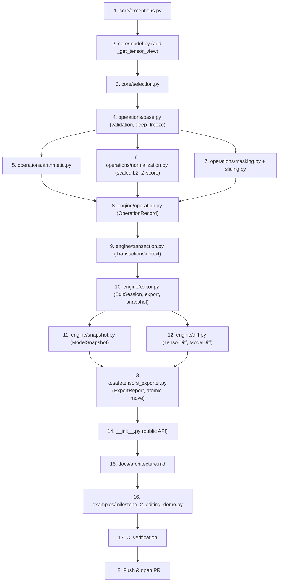

# Milestone 2 Execution Plan — Weight Editing Engine (Corrected Final Review Copy)

> [!IMPORTANT]
> This corrected plan is submitted for final approval. It is a documentation-only review artifact. No implementation code or feature branch is authorized until explicit approval; `main` remains untouched.

---

## 1. Exception Hierarchy

All new exceptions inherit from the existing `WeightSpaceError` base in `core/exceptions.py`.

| Exception Class | Parent | Purpose |
|----------------|--------|---------|
| `UnsupportedTensorDtypeError` | `WeightSpaceError` | Arithmetic on non‑floating dtypes |
| `TensorSelectionError` | `WeightSpaceError` | Invalid, cross‑session, or cross‑model tensor selection |
| `OperationValidationError` | `WeightSpaceError` | Python bool/np.bool_ scalar, non-finite operand, overflow, or post-cast failure |
| `TransactionError` | `WeightSpaceError` | Nested transaction, lifecycle call during active transaction, or concurrency error |
| `SnapshotError` | `WeightSpaceError` | Cross‑model/session snapshot or restore failure |
| `DiffMetricError` | `WeightSpaceError` | Non‑finite or unrepresentable diff metric |
| `ExportError` | `WeightSpaceError` | Verification failure, atomic move failure, or destination conflict |

---

## 2. Dataclass Schemas (Exact from Specification)

The examples below assume these imports (plus the project’s existing NumPy and checksum imports):

```python
from dataclasses import dataclass, field
from datetime import datetime, timezone
from pathlib import Path
from types import MappingProxyType
from typing import Any, Mapping, Optional, Tuple
```

### 2.1 `OperationRecord`
```python
@dataclass(frozen=True)
class OperationRecord:
    index: int                                          # Monotonic per‑session
    transaction_id: str                                 # Same for all ops in one transaction
    transaction_name: Optional[str]                     # User label or None
    operation: str                                      # e.g. "scale", "l2_normalize"
    targets: Tuple[str, ...]                            # Tensor names affected
    parameters: Mapping[str, Any]                       # Recursively frozen; stored as MappingProxyType
    before_checksums: Mapping[str, str]                 # name → wsp‑sha256‑v1 before op
    after_checksums: Mapping[str, str]                  # name → wsp‑sha256‑v1 after op
    created_at: datetime                                # timezone‑aware UTC (datetime.now(timezone.utc))
```

### 2.2 `ModelSnapshot`
```python
@dataclass(frozen=True)
class ModelSnapshot:
    snapshot_id: str
    session_id: str
    model_id: str
    name: Optional[str]
    created_at: datetime                                 # timezone‑aware UTC
    overlay: Mapping[str, np.ndarray]                    # Defensive MappingProxyType of read-only views
    history: Tuple[OperationRecord, ...]                 # Exact immutable prefix of session history
    history_length: int                                  # len(history)
```

### 2.3 `TensorDiff` and `ModelDiff`

```python
@dataclass(frozen=True)
class TensorDiff:
    name: str
    original_shape: Tuple[int, ...]
    current_shape: Tuple[int, ...]
    original_dtype: str
    current_dtype: str
    original_checksum: str
    current_checksum: str
    changed_count: int
    total_elements: int
    changed_ratio: float
    max_abs_diff: float
    mean_abs_diff: float
    l2_diff: float


@dataclass(frozen=True)
class ModelDiff:
    model_id: str
    total_tensors: int
    edited_tensors_count: int
    total_changed_elements: int
    tensor_diffs: Mapping[str, TensorDiff]  # Defensive MappingProxyType at runtime
```

`ModelDiff.tensor_diffs` is a defensive mapping copy wrapped in `MappingProxyType` during construction (use `object.__setattr__` in `__post_init__` for the frozen dataclass). The original/current shape and dtype fields are both stored even though Milestone 2 operations preserve them. Empty tensors have zero changed elements, ratio, and all three numeric metrics. Every base/current tensor is checked for finiteness before numeric metrics are calculated. If any requested metric is not representable as a finite float64, `DiffMetricError` is raised and no partial `ModelDiff` is returned.

### 2.4 Atomic Snapshot Restore Contract

`restore(snapshot)` must prepare and validate its complete replacement state before changing either session reference:

```python
def restore(self, snapshot: ModelSnapshot) -> None:
    with self._tx_lock:
        self._reject_if_in_transaction()
        validate_snapshot_type_and_schema(snapshot)
        if snapshot.model_id != self._model_id:
            raise SnapshotError("Snapshot belongs to a different model")
        if snapshot.session_id != self._session_id:
            raise SnapshotError("Snapshot belongs to a different EditSession")
        if snapshot.history_length != len(snapshot.history):
            raise SnapshotError("Snapshot history_length does not match its history tuple")

        # Build all replacement state locally; do not clear or mutate current state.
        candidate_overlay = {}
        for name, snapshot_view in snapshot.overlay.items():
            # Validate name, shape, dtype, read-only view, and that its ndarray
            # base chain terminates in a non-writeable owning array.
            validate_snapshot_tensor(name, snapshot_view)
            view = snapshot_view.view()
            view.flags.writeable = False
            candidate_overlay[name] = view
        candidate_history = list(snapshot.history)

        # Publish both references only after every validation/allocation succeeds.
        self._overlay, self._history = candidate_overlay, candidate_history
```

Snapshot creation follows the same principle: first construct a defensive mapping copy of distinct read-only views backed by read-only owning arrays, construct the immutable history tuple, and validate `history_length == len(history)`; only then return the frozen snapshot. The snapshot dataclass defensively wraps the mapping in `MappingProxyType` and verifies the history length in `__post_init__`. A failed snapshot or restore must not mutate the session.

### 2.5 `ExportReport`
```python
@dataclass(frozen=True)
class ExportReport:
    destination: Path                     # Final exported .safetensors file
    tensor_count: int                     # Number of tensors written
    edited_tensor_count: int              # Number of tensors that came from the session overlay
    total_bytes: int                      # Sum of nbytes of all exported tensors
    checksum_version: str = "wsp-sha256-v1"
    provenance: Mapping[str, str] = field(default_factory=dict)  # Frozen defensively in __post_init__

    def __post_init__(self) -> None:
        copied = {}
        for key, value in self.provenance.items():
            if not isinstance(key, str) or not isinstance(value, str):
                raise TypeError("ExportReport provenance keys and values must be strings")
            copied[key] = value
        object.__setattr__(self, "provenance", MappingProxyType(copied))
```

`ExportReport` is the return type of `session.export()` and is part of the public API (`__all__`).

---

## 3. Numerical Stability – Detailed Algorithms

All operations preserve the original tensor shape and dtype. Reductions use float64. The default epsilon is `1e-12`; callers may provide another finite, strictly positive, non-boolean real scalar. Validate the axis before handling empty arrays. Normalize axes to a unique tuple of valid dimensions; `axis=None` means all dimensions. Use `keepdims=True` for internal reduction results so every group mask broadcasts to the original tensor shape. The public result always has exactly the input shape.

### 3.1 Scaled L2 Normalization (`l2_normalize`)

The following is implementation pseudocode for all reduction groups, including mixtures of zero and nonzero groups:

```python
def l2_normalize(tensor: np.ndarray, *, axis=None, eps: float = 1e-12) -> np.ndarray:
    validate_editable_float_tensor(tensor)  # float16/32/64, finite, real
    axis = normalize_reduction_axis(axis, tensor.ndim)
    validate_positive_finite_real_scalar(eps, name="eps")

    if tensor.size == 0:
        result = np.zeros(tensor.shape, dtype=tensor.dtype)
        result.flags.writeable = False
        return result

    x = tensor.astype(np.float64, copy=False)
    with np.errstate(over="raise", invalid="raise", divide="ignore"):
        s = np.max(np.abs(x), axis=axis, keepdims=True)

        # Initialize with zeros so zero-valued groups never evaluate 0 / 0.
        nonzero_group = s > 0
        u = np.zeros_like(x, dtype=np.float64)
        np.divide(x, s, out=u, where=np.broadcast_to(nonzero_group, x.shape))

        # Since each nonzero group has at least one |u| == 1, q >= 1.
        # Thus eps / q cannot overflow for finite positive eps.
        q = np.sqrt(np.sum(u * u, axis=axis, keepdims=True, dtype=np.float64))
        threshold = np.zeros_like(q)
        np.divide(eps, q, out=threshold, where=q > 0)
        zero_or_small_group = (~nonzero_group) | (s <= threshold)

        normalized = np.zeros_like(x, dtype=np.float64)
        valid_group_mask = np.broadcast_to(~zero_or_small_group, x.shape)
        np.divide(u, q, out=normalized, where=valid_group_mask)

    result = normalized.astype(tensor.dtype)
    if not np.all(np.isfinite(result)):
        raise OperationValidationError("L2 normalization produced non-finite values after cast")
    result.flags.writeable = False
    return result
```

Important details:
- Handle `tensor.size == 0` before `np.max`; return an empty array with the original shape and dtype.
- `s` and `q` retain reduced dimensions. A zero group is handled independently from every nonzero group.
- The true norm is `s * q`. Its comparison with epsilon is performed as `s <= eps / q` for nonzero groups. Because `q >= 1`, the threshold division cannot overflow for finite `eps`.
- Never compute `s * q` just to normalize. The normalized values are calculated directly as `u / q`.
- Zero or small-norm groups return exact zeros. Preserve the original tensor shape and dtype for `axis=None`, one axis, or a tuple of axes.
- Reject invalid axes, duplicate axes, and empty axis tuples. `axis=None` is the supported all-elements reduction for a scalar tensor.

### 3.2 Stable Scaled Two-Pass Z-Score Normalization (`zscore_normalize`)

```python
def zscore_normalize(tensor: np.ndarray, *, axis=None, eps: float = 1e-12) -> np.ndarray:
    validate_editable_float_tensor(tensor)
    axis = normalize_reduction_axis(axis, tensor.ndim)
    validate_positive_finite_real_scalar(eps, name="eps")

    if tensor.size == 0:
        result = np.zeros(tensor.shape, dtype=tensor.dtype)
        result.flags.writeable = False
        return result

    x = tensor.astype(np.float64, copy=False)
    with np.errstate(over="raise", invalid="raise", divide="ignore"):
        s = np.max(np.abs(x), axis=axis, keepdims=True)
        nonzero_group = s > 0

        # Scale independently per reduction group. Zero groups remain zero.
        u = np.zeros_like(x, dtype=np.float64)
        np.divide(x, s, out=u, where=np.broadcast_to(nonzero_group, x.shape))

        # Two-pass statistics in bounded scaled space [-1, 1].
        mu_u = np.mean(u, axis=axis, keepdims=True, dtype=np.float64)
        centered_u = u - mu_u
        var_u = np.mean(centered_u * centered_u, axis=axis, keepdims=True, dtype=np.float64)
        sigma_u = np.sqrt(var_u)

        # true_sigma = s * sigma_u; compare without forming that product.
        # eps / sigma_u may overflow to +inf for extremely small sigma_u;
        # that is the mathematically correct threshold for finite s.
        threshold = np.full_like(sigma_u, np.inf, dtype=np.float64)
        # Overflow to +inf is intentional here: eps / tiny_sigma can exceed
        # float64, meaning every finite s satisfies the true-std <= eps test.
        with np.errstate(over="ignore", divide="ignore", invalid="raise"):
            np.divide(eps, sigma_u, out=threshold, where=sigma_u > 0)
        zero_or_small_group = (~nonzero_group) | (sigma_u == 0) | (s <= threshold)

        normalized = np.zeros_like(x, dtype=np.float64)
        valid_group_mask = np.broadcast_to(~zero_or_small_group, x.shape)
        np.divide(centered_u, sigma_u, out=normalized, where=valid_group_mask)

    result = normalized.astype(tensor.dtype)
    if not np.all(np.isfinite(result)):
        raise OperationValidationError("Z-score normalization produced non-finite values after cast")
    result.flags.writeable = False
    return result
```

Important details:
- Scale each reduction group before computing its mean and variance. Both passes operate on bounded values.
- Use a two-pass centered variance; do not use `mean(x*x) - mean(x)**2` on unscaled values.
- Compare the true standard deviation with `eps` without forming `s * sigma_u`: use `s <= eps / sigma_u` for `sigma_u > 0`. An infinite threshold caused by the division means every finite `s` is below the threshold and is correctly treated as a small-standard-deviation group.
- Never add epsilon to the denominator. Groups with standard deviation `<= eps`, zero groups, and constant groups return exact zeros.
- Empty tensors are handled before reductions. Mixed zero/nonzero groups are handled independently using broadcast masks. Output shape and dtype always match the input.

### 3.3 Scaled Diff Calculations (`compute_tensor_diff`)

```python
def compute_tensor_diff(name: str, orig: np.ndarray, curr: np.ndarray) -> TensorDiff:
    if orig.shape != curr.shape or orig.dtype != curr.dtype:
        raise DiffMetricError(f"Tensor '{name}' shape/dtype changed unexpectedly")

    # Validate both arrays explicitly before max(), comparisons, or subtraction.
    o = orig.astype(np.float64, copy=False)
    c = curr.astype(np.float64, copy=False)
    if not np.all(np.isfinite(o)) or not np.all(np.isfinite(c)):
        raise DiffMetricError(f"Tensor '{name}' contains non-finite values")

    total_elements = orig.size
    changed_count = int(np.count_nonzero(orig != curr))
    changed_ratio = 0.0 if total_elements == 0 else changed_count / total_elements

    if total_elements == 0:
        max_abs_diff = mean_abs_diff = l2_diff = 0.0
    else:
        m = max(float(np.max(np.abs(o))), float(np.max(np.abs(c))))
        if m == 0.0:
            max_abs_diff = mean_abs_diff = l2_diff = 0.0
        else:
            # Scale both arrays BEFORE subtraction; never form o - c first.
            delta = (o / m) - (c / m)
            abs_delta = np.abs(delta)

            max_norm = float(np.max(abs_delta))
            mean_norm = float(np.mean(abs_delta, dtype=np.float64))

            # Scaled sum-of-squares on bounded normalized differences.
            dscale = float(np.max(abs_delta))
            if dscale == 0.0:
                l2_norm = 0.0
            else:
                unit_delta = abs_delta / dscale
                sum_sq = float(np.sum(unit_delta * unit_delta, dtype=np.float64))
                l2_norm = dscale * float(np.sqrt(sum_sq))

            # Rescaling can legitimately exceed float64 even when intermediates do not.
            with np.errstate(over="ignore", invalid="ignore"):
                max_abs_diff = m * max_norm
                mean_abs_diff = m * mean_norm
                l2_diff = m * l2_norm
            _require_finite_metric(name, "max_abs_diff", max_abs_diff)
            _require_finite_metric(name, "mean_abs_diff", mean_abs_diff)
            _require_finite_metric(name, "l2_diff", l2_diff)

    return TensorDiff(
        name=name,
        original_shape=tuple(orig.shape),
        current_shape=tuple(curr.shape),
        original_dtype=str(orig.dtype),
        current_dtype=str(curr.dtype),
        original_checksum=compute_tensor_checksum(orig),
        current_checksum=compute_tensor_checksum(curr),
        changed_count=changed_count,
        total_elements=total_elements,
        changed_ratio=changed_ratio,
        max_abs_diff=max_abs_diff,
        mean_abs_diff=mean_abs_diff,
        l2_diff=l2_diff,
    )
```

```python
def _require_finite_metric(tensor_name: str, metric_name: str, value: float) -> None:
    if not np.isfinite(value):
        raise DiffMetricError(
            f"Metric '{metric_name}' for tensor '{tensor_name}' is not representable as finite float64"
        )
```

Call this helper for every rescaled metric, and check any intermediate that is rescaled again. It raises `DiffMetricError` naming the tensor and metric if its value is NaN or infinity. `changed_count` uses exact comparison in the original dtypes after both arrays have passed finite validation. Empty tensors return zero metrics. Float64 finite underflow is accepted; unrepresentable metrics raise `DiffMetricError`.

## 4. Operation Atomicity (Candidate State Prepared Before Publish)

### 4.1 Revised `_execute_operation`

1. Acquire `self._tx_lock` (re-entrant for the transaction-owning thread).
2. Resolve the active overlay and history: staged state for the owner thread inside an explicit transaction; committed state otherwise.
3. Resolve and validate every target deterministically.
4. Compute all target results into a private local dictionary. Do not mutate the active overlay.
5. Compute before/after checksums and validate every result, shape, dtype, and read-only owner array.
6. Construct the immutable `OperationRecord` completely, including recursively frozen parameters and timezone-aware UTC timestamp.
7. Build a candidate overlay mapping from a shallow copy of the active mapping, then apply all local results to that candidate.
8. Build a candidate history list from the active history, then append the complete record.
9. Only after all preparation succeeds, publish both candidate references together while still holding the lock:
   - In an explicit transaction, replace `_staged_overlay` and `_staged_history` with the candidates.
   - For an implicit single-operation transaction, replace `_overlay` and `_history` with the candidates.
10. If any validation, computation, checksum, record construction, or candidate-state preparation step fails, publish neither candidate. The operation leaves the active overlay and history unchanged.

All readers and writers must access committed/staged state under the same RLock. Publishing the two candidate references occurs inside one critical section; no other session method can observe an overlay/history mismatch.

### 4.2 Transaction and lifecycle synchronization

The session owns one `threading.RLock` and explicit state protected by that lock:

```python
self._tx_lock = threading.RLock()
self._transaction_active = False
self._transaction_owner: int | None = None
self._transaction_id: str | None = None
self._transaction_name: str | None = None
self._staged_overlay = None
self._staged_history = None
```

- Transaction entry acquires the RLock and holds it for the complete context block. Under the lock, reject if `_transaction_active` is already true (this catches same-thread nesting because RLock is re-entrant), then set active state and owner ID and create shallow staged mapping/history copies.
- Operations made by the owner thread re-enter the same RLock and work only against staged state. Other threads block on the RLock and cannot join or observe staged data.
- On successful context exit, publish the fully prepared staged overlay and history under the lock. On an uncaught exception, discard staged state. Always clear transaction metadata and release the lock in `finally`.
- A failed operation is locally atomic. If its exception is caught inside the context, the explicit transaction remains open and other successful operations may still commit. If the exception escapes the context, the whole transaction aborts.
- Every lifecycle method (`snapshot`, `restore`, `rollback`, `diff`, and `export`) acquires the same RLock and then checks `_transaction_active`. The owning thread re-enters the lock and receives `TransactionError`; a different thread blocks until the transaction commits or aborts, then proceeds against committed state.
- Do not query RLock internals or use `RLock.locked()`. The explicit state flag is read only while holding the RLock, eliminating check/use races.
- `export()` captures immutable references and expected checksums while holding the lock, then releases it before serialization and filesystem I/O.

### 4.3 Explicit transaction commit

At transaction entry, hold the session RLock throughout the context and create shallow candidate copies of the committed overlay and history. Operations update only staged candidate references after their individual atomic preparation succeeds. On normal exit, prepare the final committed candidate references and publish the overlay and history under the lock before clearing transaction state. If an exception escapes the context body, discard staged references and preserve committed state. A caught operation exception does not automatically abort the transaction; successful operations before and after that caught failure can commit. Each successful operation retains its own `OperationRecord`; records in the same transaction share one transaction ID.

## 5. Export Mechanics – `ExportReport`

### 5.1 Public API and immutable report

```python
@dataclass(frozen=True)
class ExportReport:
    destination: Path
    tensor_count: int
    edited_tensor_count: int
    total_bytes: int
    checksum_version: str = CHECKSUM_VERSION
    provenance: Mapping[str, str] = field(default_factory=dict)

    def __post_init__(self) -> None:
        copied: dict[str, str] = {}
        for key, value in self.provenance.items():
            if not isinstance(key, str) or not isinstance(value, str):
                raise TypeError("ExportReport provenance keys and values must be strings")
            copied[key] = value
        object.__setattr__(self, "provenance", MappingProxyType(copied))
```

`session.export(path, *, overwrite=False) -> ExportReport` is the only public export interface. `destination` is the resolved final path; `total_bytes` is the sum of tensor `nbytes` captured for the export. `Mapping` is used as the annotation; each report defensively copies and freezes caller-provided provenance. `ExportReport` is exported from the package root.

### 5.2 State capture (inside the session lock)

```python
with self._tx_lock:
    self._reject_if_in_transaction()
    tensors_to_export: dict[str, np.ndarray] = {}
    edited_tensor_count = 0
    total_bytes = 0
    for name in self._model.tensor_names:
        if name in self._overlay:
            arr = self._overlay[name]                 # immutable overlay reference
            edited_tensor_count += 1
        else:
            arr = self._model._get_tensor_view(name)  # read-only base view
        tensors_to_export[name] = arr                 # capture reference; do not copy payload
        total_bytes += arr.nbytes
    expected_checksums = {
        name: compute_tensor_checksum(arr)
        for name, arr in tensors_to_export.items()
    }
    captured_provenance = build_export_provenance(self._model.metadata, self._model.model_id)

# Lock released only after the committed state and its references are captured.
# Serialization and filesystem I/O happen outside the session lock.
```

Base arrays and published overlay owners are immutable under the supported API. The exporter may create contiguous serialization buffers when the Safetensors backend requires them, but opening/capturing the export state must not make a second full-model defensive copy. The export report's byte count is the sum of `nbytes` from the captured tensors.

### 5.3 Windows `MoveFileExW` configuration

```python
import ctypes
from ctypes import wintypes

kernel32 = ctypes.WinDLL("kernel32", use_last_error=True)
move_file_ex = kernel32.MoveFileExW
move_file_ex.argtypes = (wintypes.LPCWSTR, wintypes.LPCWSTR, wintypes.DWORD)
move_file_ex.restype = wintypes.BOOL

# Flags = 0 means no replacement. MOVEFILE_REPLACE_EXISTING is 0x1.
if not move_file_ex(str(temp_path), str(destination), 0):
    error_code = ctypes.get_last_error()
    raise ExportError(
        f"MoveFileExW no-overwrite publish failed (Windows error {error_code})"
    )
```

Use `wintypes.BOOL` for the Windows 32-bit BOOL return type, wide-character path arguments, `wintypes.DWORD` for flags, and `use_last_error=True`. Flags zero means no replacement; do not describe it as `MOVEFILE_REPLACE_EXISTING` (that flag is `0x1`). Never fall back to `os.replace` when `overwrite=False`.

### 5.4 Export pipeline

1. Validate path, parent directory, suffix, and the boolean `overwrite` argument.
2. Under the session lock, reject active transactions and capture immutable tensor references, expected checksums, metadata, and report statistics.
3. Create an exclusive temporary file in the destination directory (same filesystem).
4. Serialize all tensors and metadata to the temporary Safetensors file; flush, close, then `os.fsync` the file descriptor where supported.
5. Reload the temporary file with the existing loader. Verify exact tensor names, shapes, dtypes, checksums, and expected metadata.
6. Publish only after verification:
   - `overwrite=False`, Windows: `MoveFileExW(temp, destination, 0)`.
   - `overwrite=False`, POSIX: `os.link(temp, destination)` followed by `os.unlink(temp)`.
   - `overwrite=True`, both platforms: `os.replace(temp, destination)`.
7. Where supported, fsync the destination parent directory after successful POSIX publication (best effort). Document atomic visibility separately from crash durability.
8. Clean up any remaining temporary path on every error. Never remove or modify an existing destination when writing, fsync, verification, or no-overwrite publishing fails.
9. Return an `ExportReport` only after successful publication and verification, including destination, tensor count, edited tensor count, total bytes, checksum version, and frozen provenance.

The no-overwrite paths must never call `os.replace` as a fallback. Unsupported atomic-link/move behavior is an `ExportError`, not permission to weaken the guarantee.

## 6. Documentation Update – NumPy Writeable Flag
- Every published overlay owning array is marked `writeable = False` before any view is exposed. Base model owners are also non-writeable.
- Snapshot and private tensor views are distinct read-only views backed by those non-writeable owners; public `get_tensor()` APIs return defensive copies.
- This is an API-level protection against accidental mutation, not a security boundary against a caller deliberately traversing NumPy `.base` references or using unsupported low-level techniques. Do not describe NumPy flags as permanently tamper-proof.

---

## 7. Requirement → File → Test Mapping (unchanged except for new items)
| Spec Section | Implementation File | Test Module |
|--------------|---------------------|-------------|
| Exception hierarchy | `core/exceptions.py` | exercised by all tests |
| `_get_tensor_view` | `core/model.py` | `tests/test_model_view.py` |
| `TensorSelection` | `core/selection.py` | `tests/test_selection.py` |
| Validation utilities + `deep_freeze` | `operations/base.py` | `tests/test_operations_validation.py` |
| Arithmetic (float64) | `operations/arithmetic.py` | `tests/test_operations_arithmetic.py` |
| Scaled L2 & Z-score | `operations/normalization.py` | `tests/test_operations_normalization.py` — empty tensors, mixed zero/nonzero groups, axis=None/int/tuple, scalar where supported, shape/dtype preservation |
| Masking / slicing | `operations/masking.py`, `operations/slicing.py` | respective test files |
| `OperationRecord` | `engine/operation.py` | `tests/test_operation_record.py` |
| Transaction context (nested‑rejection, staging) | `engine/transaction.py` | `tests/test_transactions.py` |
| `EditSession` (CoW, lifecycle guards, cross‑thread behavior) | `engine/editor.py` | `tests/test_editor.py`, `tests/test_lifecycle.py` |
| `ModelSnapshot` (exact history) | `engine/snapshot.py` | `tests/test_snapshots.py`, `tests/test_restore.py` |
| `TensorDiff` / `ModelDiff` (scaled metrics) | `engine/diff.py` | `tests/test_diff.py` |
| Export (`ExportReport`, atomic move, immutability) | `io/safetensors_exporter.py` | `tests/test_export.py` |
| Public API exports (`EditSession`, `TensorSelection`, `ModelSnapshot`, `OperationRecord`, `TensorDiff`, `ModelDiff`, `ExportReport`, exceptions) | `__init__.py` | import sanity test in CI |
| Documentation (writeable flag note) | `docs/architecture.md` | N/A |
| Example end‑to‑end script | `examples/milestone_2_editing_demo.py` | N/A |

---

## 8. Dependency Graph (unchanged)


---

## 9. Technical Risks & Mitigations (updated for new details)
| Risk | Mitigation |
|------|------------|
| **L2/Z‑score division by zero** – handling of groups where `s` or `sigma_u` is zero | Explicit zero‑mask logic returns exact zeros; finiteness checks catch any unexpected NaNs. |
| **Diff scaling factor `m` non‑finite** – original tensor may contain NaNs/Inf | Early detection raises `DiffMetricError` before any metric computation. |
| **Export atomic move on network drives** – `MoveFileExW` may return FALSE with `ERROR_NOT_SUPPORTED` |
| | Propagate as `ExportError` with error code; documentation notes that no‑overwrite is guaranteed only on local filesystems. |
| **Thread deadlock if external code acquires `_tx_lock`** – private attribute, not exposed. |
| **Memory pressure for large overlays** – snapshots store references, not copies; overlay holds only edited tensors. |
| **Platform‑specific ctypes mis‑configuration** – unit tests mock the call and verify argument types; integration tests run on actual Windows CI runner. |

---

## 10. Required Edge-Case Tests Added by This Revision

- **Normalization:** empty arrays are returned with the exact input shape/dtype without calling reductions; mixed zero and nonzero groups normalize independently; L2 epsilon uses the true norm comparison; z-score zero/constant groups return exact zeros; `axis=None`, integer axes, tuple axes, negative axes, duplicate/invalid axes, and scalar tensors are covered where the API supports them. Reject both Python `bool` and `np.bool_` for all numeric scalar operands including epsilon and bounds.
- **Diff:** both original and current arrays are explicitly checked for finiteness before calculating the scale; scaling happens before subtraction; exact `changed_count` is preserved; all metric rescaling is checked; any non-finite/unrepresentable metric raises `DiffMetricError`.
- **Operation publication:** failure during result computation, checksum calculation, record freezing, or candidate-state construction leaves both overlay and history unchanged. Candidate overlay/history references are prepared before publication under the same lock.
- **Snapshot restore:** replacement overlay views and replacement history are fully built and validated before either session reference is changed; simulated failure during preparation leaves the prior state unchanged. Cross-model and cross-session restores are rejected; history is replaced with the exact snapshot tuple. Snapshot view `.base` chains are checked to terminate in non-writeable owning arrays.
- **Export report:** default provenance is created with `field(default_factory=dict)` and frozen defensively in `__post_init__`; input mappings cannot mutate the report after construction; destination, tensor count, edited count, total bytes, and checksum version are verified.
- **Windows API:** assert `MoveFileExW.argtypes` use `LPCWSTR`, `LPCWSTR`, `DWORD`, and `restype` uses `BOOL`; flags zero is no-replace; a failure captures `ctypes.get_last_error()` and never triggers `os.replace` for `overwrite=False`.
- **Metadata:** unrelated source metadata survives export; only reserved `weightspace.*` keys are deterministically replaced; every Safetensors metadata value remains a string.
- **POSIX cleanup:** after `os.link` successfully publishes the destination, failure to unlink the temporary second name is treated as a cleanup warning/retry, not as a failed export that would misleadingly report failure after publication. The final destination remains the successful verified artifact.

---

## 11. Commit Sequence (unchanged except for new ExportReport commit)
| # | Commit Description |
|---|-------------------|
| 1 | Add new exception classes to `core/exceptions.py` |
| 2 | Add `_get_tensor_view` to `core/model.py` + `tests/test_model_view.py` |
| 3 | Implement `TensorSelection` (`core/selection.py`) + tests |
| 4 | Implement validation utilities & `deep_freeze` in `operations/base.py` + tests |
| 5 | Implement arithmetic ops (`operations/arithmetic.py`) + tests |
| 6 | Implement scaled L2 & stable Z‑score in `operations/normalization.py` + tests |
| 7 | Implement masking & slicing (`operations/masking.py`, `operations/slicing.py`) + tests |
| 8 | Implement `OperationRecord` (immutable) in `engine/operation.py` + tests |
| 9 | Implement `TransactionContext` with nested‑rejection, staging, and atomic publish in `engine/transaction.py` + tests |
|10 | Implement `EditSession` (CoW, lifecycle guards, export state capture, `ExportReport`) in `engine/editor.py` + tests (`test_editor.py`, `test_lifecycle.py`) |
|11 | Implement `ModelSnapshot` (exact history) in `engine/snapshot.py` + tests (`test_snapshots.py`, `test_restore.py`) |
|12 | Implement `TensorDiff` / `ModelDiff` with scaled metrics in `engine/diff.py` + tests (`test_diff.py`) |
|13 | Implement atomic Safetensors exporter, Windows `MoveFileExW` ctypes config, and return `ExportReport` in `io/safetensors_exporter.py` + tests (`test_export.py`) |
|14 | Update public API in `__init__.py` (add new exceptions, `ExportReport`, etc.) |
|15 | Update documentation (`docs/architecture.md`) – writeable‑flag boundary note |
|16 | Add example script `examples/milestone_2_editing_demo.py` |
|17 | Run full CI matrix; fix any failures |
|18 | Push branch `feat/milestone-2-editing-engine` and open PR |

---

**All six remaining corrections are now incorporated.** Please review the updated plan and provide final approval.

---

*Artifact location:* [Milestone2_ExecutionPlan_Final.md](file:///C:/Users/Aadu/.gemini/antigravity/brain/63289975-82ad-4fb0-ac07-103b7377f067/Milestone2_ExecutionPlan_Final.md)